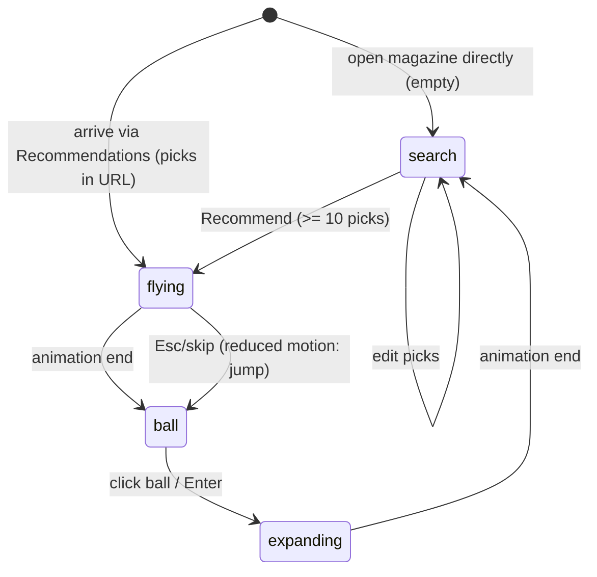

# magazine — design draft (apps/magazine)

Status: design with decisions closed (§12, 2026-10-10); roadmap steps 1 (shared packages), 2 (Discovery `?cards=recommend`), 3 (magazine shell, empty state) and 5 (scoring and rows, unit-tested) are built on 2026-10-11; the sphere states (4), the detail page (6) and collections (7) are built on 2026-10-11 too; series blocks/templates (8) are not. A separate Svelte app next to `apps/discovery`. Reads `plan/CODEGEN-X.md` (§1, §5, §6, layouts list) and reuses the real Discovery data (`tastes.ts`, `compositions.ts`, `curated.ts`, `included.json`, `engine/*`, `plan/included-styles.md`).

## 1. Purpose

The magazine is the journal, warehouse and storage of everything a visitor collects: collections ("подборки"), design packs, templates, presets. Its goal: **help the user choose a style and a taste, and see that taste in different representations** (other blocks, other templates, other skins/fonts/radii). Discovery is where taste is *searched*; the magazine is where it is *shown, compared and kept*.

User flow (translated from the user's wording):

1. On the Discovery panorama the user selects **10 screens**. A **"Recommendations"** button appears; the selection can be cleared to keep searching.
2. Pressing it navigates to the magazine, which shows **collections** (подборки).
3. If the magazine is opened **directly** it is **empty**: only the rotating sphere of screens is shown.
4. After arriving via the button, the sphere **collapses and flies into the header** as a small spinning ball of screens (just a ball, "not magic"). Clicking the ball **expands the sphere again** so the user can redefine the recommendations.
5. Recommendations are **cards of screens similar in colour and style**, in **rows that alternate with fonts and skins rows**.
6. A card's **detail page** shows the other screens of this series (same design in other blocks: hero, features, cta, hero-right, …), the **10 ready-made templates** (blog, store, portfolio, website, dashboard, SaaS landing, docs, … — the 10 layouts in CODEGEN-X.md "Templates tab") and the **composition patterns** of the design.

Note: CODEGEN-X.md used to say Jev needs ≥ 8 picks; it is now **10** (§12, decision 4), and CODEGEN-X.md §1 item 2 is updated. `MIN_PICKS = 10` is one constant in the shared vocabulary.

Fixed constraints (not re-opened): Svelte only; previews are CSS-scaled desktop-width (1440×1080) screens in the same DOM, never iframes; no mobile simulator, no container queries; brand-free neutral English copy; ui8kit 2.0 rules (8px step, 4px only inside controls, plain `rounded` tied to `--radius`, no gradients in primitives — gradients/blur/grain only inside procedural media recipes, shadows only on floating surfaces, Tailwind-named size keys); skin = CSS variables (HSL).

**Dependency (planned separately):** per-element tokens `--radius-button/card/badge/alert/media`, density `compact|default|comfortable`, `--shadow-*`. The magazine's "radius" and a future "density" axis map onto them; until they exist, only the single `--radius` is used (as Discovery does today).

## 2. The sphere: three states

The sphere is the same Three.js panorama as Discovery (`engine/panorama.ts`, 48 cards at the equator, 21 rows, ±60°, 1440×1080 screens, snapshots in IndexedDB).

| State | Where | What |
|---|---|---|
| `search` | Discovery (always); magazine when empty or re-opened | full-screen sphere, drag/inertia/zoom, double-click picks, picks counter and the **Recommendations** button at 10 picks |
| `flying` | magazine, once, after arriving from the button | ~700 ms: camera dolly out + sphere scale/translate to the header slot; cards stay textured, no new snapshot work; reversible |
| `ball` | magazine header (48×48 px slot) | the same sphere at tiny size, slow spin, no interaction except click; a plain ball of screens, no glow or effects |



Rules: one WebGL context per page; in `ball` the render loop runs at ~15 fps and pauses when the tab is hidden or the ball is off-screen; `prefers-reduced-motion` replaces `flying`/`expanding` with a cross-fade. In `search` from the magazine the picks are pre-selected (outlined), the user edits them and presses Recommend again → `flying` → recomputed rows. Closing `search` without pressing keeps the old recommendations.

## 3. Routes and URL params

Hash routing (as in Discovery: query survives navigation).

| URL | View |
|---|---|
| `/` (no picks, nothing stored) | empty state: sphere in `search`, no collections |
| `/?picks=<id>,<id>,…` | recommendations for these picks (ids = Style keys, see §4; URL-safe encoding `~` for `\|`, `+` kept) ; triggers `flying` when coming from Discovery |
| `/#/` | home of the magazine = collections + recommendation rows (from `picks` or localStorage) |
| `/#/style/<key>` | detail page of one Style |
| `/#/collection/<id>` | one collection |
| `/#/packs`, `/#/templates`, `/#/presets` | warehouse lists (later steps) |

Link from Discovery: `…/magazine/?picks=…` (a normal navigation; the two apps are separate builds). Relation to Discovery's `cards=` modes:

- `cards=all` (keep), `cards=exclude`: unrelated to the magazine; unchanged.
- `cards=include` stays the curator's tool (marketplace showcase, `included.json`). Magazine picks are a **new, fifth mode `?cards=recommend`** in Discovery: picks are Style descriptors (`screen|skin|font|radius`, same as the include descriptors), stored in `discovery-picked-recommend`, no Send to the :5190 server; the button is **Recommendations**, enabled strictly at 10 picks (`MIN_PICKS`, never earlier) and showing `n/10`. Clearing = a "Clear" link beside the button.
- Included styles (`included.json`, 90 at the time of writing) are a ranking boost and the seed of the warehouse, not a gate for picks; they are the only styles with authored series and templates (§12, decision 3).

## 4. Data model

All ids are lowercase tokens, plain data, same vocabulary as the CLI (CODEGEN-X.md 2.1).

```ts
type StyleKey = `${ScreenId}|${SkinId}|${display}+${body}|${Radius}`; // = variantKey() in taste.ts
type Style = { key: StyleKey; screen: ScreenId /* t001…t146 */; skin: SkinId; fonts: FontPair; radius: Radius;
               recipe: Recipe; composition: Composition /* layout family */; pattern: { primary: Pattern; secondary?: Pattern };
               included: boolean };
type Series  = { id: string; skin: SkinId; fonts: FontPair; radius: Radius;      // "same design, other blocks"
                 blocks: { block: "hero"|"hero-right"|"features"|"cta"|"pricing"|"testimonials"|…; screen: ScreenId }[] };
type Template = { id: "classic"|"two-column"|"three-column"|"sidebar"|"dashboard"|"blog"|"store"|"portfolio"|"saas-landing"|"docs";
                  landmarks: string[]; slots: string[] };                         // semantic HTML5 skeleton, skin-agnostic
type Pack    = { id: string; style: StyleKey; series: Series; templates: Template["id"][]; tokens: "skin css vars" };
type Preset  = { format: 1; picks: StyleKey[]; skin; fonts; radius; blocks?: string[]; templates?: string[] }; // what `npx cgenx` reads
type Collection = { id: string; title: string; kind: "recommended"|"manual"|"pack"; styles: StyleKey[]; created: string };
type Pick    = { style: StyleKey; time: string; source: "sphere"|"card" };       // one event, same names as CLI flags
```

Real data today: 146 screens (`TASTES`, each with its own skin/fonts/radius/recipe/deck), 15 skins (`SKIN_IDS`), radii `0,4,8,12,16`, the font set of `fonts.ts`, 10 recipes, 9 composition patterns (8 used), `COMPOSITION_OF` per screen. The sphere's variations (another skin, fonts, radius over one screen) mean the full space is `screens × skins × font pairs × radii`; a Style is one point in it. A Series = one `(skin, fonts, radius)` rendered over the block screens of one family; until Series blocks exist (§10) a detail page shows a Series made of the screens whose layout family matches.

## 5. Recommendation: deterministic, no ML (v1)

Input: picks `P` (≥ 10 Styles). Candidates `C`: all `screens × skins × font pairs × radii` generated lazily, but v1 ranks **per axis** so no huge product is built:

1. **Taste profile** from `P`: mean skin colour (light and dark), skin histogram, font-pair histogram, radius mean, pattern histogram, layout-family histogram, recipe histogram. Colour = skin tokens `--primary`, `--background`, `--foreground`, `--accent` (HSL from the skin css, as `engine/colors.ts` reads them) converted to **OKLab**; skin distance `dC(a,b) = ½·(ΔE(primary)+ΔE(background))` + 0.25·ΔE(accent), with ΔE = Euclidean distance in OKLab, normalised to 0..1 by the max over the 15 skins.
2. **Style score** for a candidate `s` (all terms in 0..1, higher = closer):

```
score(s) = 0.30·colour(s) + 0.20·pattern(s) + 0.15·layout(s) + 0.15·font(s) + 0.10·radius(s) + 0.05·recipe(s) + 0.05·included(s)
colour  = 1 − min over picks p of dC(s.skin, p.skin)   (blend with mean over picks: 0.6·best + 0.4·mean)
pattern = 1 if primary equal to a pick's primary; 0.6 if primary matches a secondary (or vice versa); 0.3 for secondary–secondary; weak:true halves it
layout  = share of picks with the same layout family (`composition`)
font    = 1 same pair; 0.7 same display; 0.5 same body; else 0.3·(same category: sans/serif/mono/rounded)
radius  = 1 − |r − mean(pick radii)| / 16
recipe  = share of picks with the same recipe
included= 1 if the style is in included.json else 0
```
3. **Diversity:** greedy pick with a penalty `−0.25` for a candidate sharing screen or skin with an already placed neighbour in the row (same rule as `engine/curate.ts`: no neighbour shares a screen or a skin). Picks themselves are never recommended back.
4. **Deterministic:** ties break by `key`; no randomness. Weights live in one `weights.ts`; a unit test runs the picks of the `curated.ts` rows and asserts that top results stay in the same colour family.

Score runs in the browser, < 20 ms for 146 screens × 15 skins on the ranking index (feature cards, CODEGEN-X.md 2.3), precomputed OKLab per skin at build time. ML/Jev replaces only `score()` later; rows and UI stay.

## 6. Recommendation rows

Rows alternate, each a horizontal strip of 6 cards (desktop width ≥ 1280 shows 6; narrower, scrolls horizontally; no container queries — cards grow from 200 to 360 px to fill the row, a row of 6 fits from about 1280 px, narrower it scrolls):

1. **Screens by similarity** — top Styles by `score` (card = scaled 1440×1080 screen with its skin/fonts/radius).
2. **Fonts** — the best font pairs for the profile, each shown on the same neutral screen (the best-scoring screen) so only type changes.
3. **Skins** — the nearest skins by `colour`, same screen, light/dark switch per row.
4. **Screens by similarity** (next 6).
5. **Radii** — 0/4/8/12/16 on the best screen.
6. **Compositions** — the best screen of each pattern in the profile (labelled by pattern).
7. repeat from 1 with the next ranks. Every card links to `#/style/<key>`; a heart adds it to a Collection. Row headers are neutral English labels; a "Why" tooltip lists the top two score terms (e.g. "close colour, same pattern").

The first collection created automatically is "Recommended for these 10" (kind `recommended`).

## 7. Detail page `#/style/<key>`

Top to bottom (one scroll):

1. Header: big preview (scaled screen), style name = `screen · skin · fonts · r<radius>`, light/dark toggle, `Add to collection`.
2. **Series** — the same design in other blocks (hero, hero-right, features, cta, pricing, testimonials, …) as a row of scaled previews. Authored only for included styles; any other style shows the series of its nearest included style (labelled as such), a stub row ("coming") where that has no block yet.
3. **Templates** — the 10 layouts (classic, two-column, three-column, sidebar, dashboard, blog, e-commerce/store, portfolio, SaaS landing, documentation) as semantic HTML5 skeletons skinned by this style; tabs or a grid of 10 scaled previews; open one in a new browser window (no simulator).
4. **Composition** — pattern name(s) from `compositions.ts` with its one-line note, and a thin overlay of the pattern on the preview (thirds lines, diagonal, L, radial…; SVG overlay, toggle).
5. **Tokens** — skin colours (swatches, light/dark), font pair specimen, radius, spacing (8px step). Shows planned per-element tokens as disabled rows until they exist.
6. **Download / preset (stubs)** — "Copy preset" (JSON `Preset`, §4) and the line `npx cgenx add --skin … --font … --radius …` (command shape follows the future CLI; button disabled with "later" label until step 3 of CODEGEN-X.md §3).
7. Related styles: 6 nearest by `score` against this style alone.

## 8. Persistence and empty state

- **Now: localStorage only** (decision 5; collections are never shared by URL) under `magazine:v1:{picks,collections,presets}`; Discovery's `discovery-picked-recommend` is read once and merged. URL `picks=` wins over storage and is written back. A "Reset" in the header menu clears all.
- **Later: account** (Jev / registry). Same JSON shapes, synced by `Pick` events (CODEGEN-X.md 2.1); localStorage becomes a cache.
- **Empty state** (direct open, no picks, no storage): header without a ball; the sphere in `search` fills the page; one neutral line "Pick 10 screens to get recommendations" and the counter. Nothing else is rendered — no collections, no rows, no placeholders. With stored picks but no URL, the page opens on `#/` with the ball already in the header (no flight).

## 9. Accessibility and performance

- Sphere: canvas has an equivalent **list mode** (a toggle: grid of the same cards, keyboard focusable, Space picks) — double-click-only picking is not keyboard reachable. Ball is a `<button aria-label="Open the sphere to change recommendations">`; focus moves to the sphere when expanded and back to the ball on close. Reduced motion respected (§2). Colour is never the only signal: picked cards also carry an outline and a check; contrast of UI text follows the active skin (skins are already contrast-measured, `wave-contrast.json`).
- Previews: mount only visible cards (IntersectionObserver), `content-visibility: auto`, 1440-wide frame scaled by CSS transform; off-screen cards fall back to the **snapshot** (WebP) from the shared cache.
- **Profile:** reuse `engine/profile.ts` (`full` vs `light`, prefix `s2`/`m2`, `?profile=` override). The magazine uses the same IndexedDB cache, so a visit after Discovery has the snapshots already (decision 1: both apps are served from one origin, `/discovery/` and `/magazine/`).
- Budget: first rows interactive < 1 s on warm cache; ≤ 36 live DOM previews at once; the ball renders ≤ 48 low atlas cells (64×48 far cells).

## 10. What must exist first

1. **`packages/panorama`** — extract `engine/{grid,panorama,profile,snapshot,loader,cache}.ts` (and the WebGL-free parts of `wall`/`assign`/`curate`) behind a small API: `new Panorama(canvas, { cards, profile })`, `setMode("sphere"|"ball")`, `fly(to: DOMRect)`, `onPick`. Discovery imports it via a workspace alias; the extraction is **mechanical (move + re-export)**, wall output byte-for-byte unchanged (check: `bun run included --dry` and a wall hash before/after).
2. **`packages/taste-data`** (or `shared`) — `tastes`, `compositions`, `included`, skin OKLab table, `variantKey`, so both apps read one source.
3. **Series blocks per included style** (90 now; the rest derive from the nearest included style, §12) — authored block screens (hero-right, features, cta, pricing, testimonials, …), rendered by the same Svelte screens with skin/fonts/radius variables. Needs an index screen → block family.
4. **10 template skeletons** (CODEGEN-X.md "Templates tab"), semantic HTML5, 8px grid, skinned by CSS variables.
5. Per-element radius/density/shadow tokens (dependency, §1) — optional for v1, required for the Tokens panel to be real.

Built 2026-10-11 (stages 1-3 of the turnkey build): `?cards=recommend` and `MIN_PICKS`/`StyleKey` helpers in `packages/taste-data/src/picks.ts`; `apps/magazine` (hash router, base `/magazine/`, empty state = the slowly turning sphere via `Panorama.setDrift`, one WebGL context); screens/recipes/parts moved to `packages/taste-screens`; the recommender in `packages/taste-data/src/recommend/` (`weights.ts` holds every number; skin colours as OKLab in `skin-colors.ts`, generated by `bun run skin-colors`); cards are snapshot-first with live DOM only on screen (≤ 36). Deviations from the text above, by the dispatch: the font rows show the same screen in alternative **single** fonts (display = body), a style in a screens row keeps its screen's own font pair, and the skins row has no light/dark switch yet.

## 11. Roadmap (small steps, each with an acceptance check)

1. **Extract `packages/panorama` + `taste-data`.** Check: Discovery builds, `bun run check` clean, wall hash unchanged, both caches (`s2`, `m2`) still hit.
2. **Discovery `?cards=recommend`.** 10-pick counter, Clear, Recommendations button, link with `picks=`. Check: button appears only at ≥ 10, Clear works, other modes unaffected.
3. **`apps/magazine` shell.** Routes, empty state with the sphere. Check: direct open shows only the sphere; `/?picks=` skips it.
4. **Sphere states.** `search → flying → ball → search` with reduced-motion path. Check: state diagram transitions all reachable; one WebGL context; ball idles ≤ 15 fps.
5. **Scoring + rows** (§5–6) with unit tests. Check: same picks → same rows; picks never returned; no two neighbours share screen or skin.
6. **Detail page** without series (screens of the same family) + composition overlay + tokens + preset stubs. Check: every row card opens a page; Copy preset yields valid JSON.
7. **Collections + persistence.** Heart, `#/collection/<id>`, localStorage. Check: reload keeps state; Reset clears.
8. **Series blocks** for the first included styles, then **10 templates** (one per step each). Check: the detail page shows real series/templates for ≥ 10 styles; a template re-skins on skin switch with no rebuild.
9. **Presets/packs warehouse and `npx cgenx` export** (after CODEGEN-X.md order step 3). Later: Jev scoring and account sync.

## 12. Decisions (2026-10-10)

The open questions of the first draft are closed:

1. **One origin.** `/discovery/` and `/magazine/` are served together from one origin, so both apps share the IndexedDB snapshot cache (`s2` / `m2`). No separate domain.
2. **The 10 picks are exact Styles.** A pick is `screen|skin|fonts|radius` of the picked card (`StyleKey`, as with `cards=include`), not just a screen. Recommendations diversify around close exact styles.
3. **Series blocks and templates only for included styles** (90 now, `included.json`). Every other style derives its series and templates from the nearest included style (nearest by `score()` against that style alone); coverage improves later by including more styles.
4. **Recommendations unlock strictly at 10 picks** (`MIN_PICKS = 10`). Fewer picks never open the feed, so it never looks empty or thin; returning visitors use their stored picks.
5. **Collections are local only** (`localStorage`, `magazine:v1:collections`). No share-by-URL and no account: a prototype of a future full design store. Only `picks=` (the 10 Styles) travels in a URL, from Discovery to the magazine.

## 13. Built: sphere states (2026-10-11)

One canvas, one WebGL context, four phases (`apps/magazine/src/parts/sphere.svelte`): `empty` (no picks: the full-screen sphere, a slow turn, nothing else), `flying` (arriving with `?picks=`: the stage collapses into the header slot by a CSS transform + clip circle (Web Animations) while the camera backs out, `Panorama.setBall(t)`), `ball` (56 px ball in the header: drawn at ~15 fps into a small buffer (`setFps`, `setRenderScale`), no input, drawing paused while the tab is hidden), `expanding`/`search` (click or Enter on the ball: the reverse flight, the 10 picks outlined, double-click edits, **Apply recommendations** at exactly 10 writes `?picks=` and `magazine:v1:picks` and recomputes the rows, **Cancel**/Esc keeps the old ones). Reduced motion cross-fades instead of flying. Picks: URL wins; else `magazine:v1:picks`; else Discovery's `discovery-picked-recommend` (same origin), merged when each list alone is short. In the ball the cards show from outside (the back of a card is mirrored by the shader), touch each other and have no shadows; the loader keeps filling the cards that face the ball.

## 14. Built: the detail page (2026-10-11)

`#/style/<key>` (`apps/magazine/src/parts/style-page.svelte`): a live, CSS-scaled 1440×1080 preview of the exact style (no iframe); the **series** = the same skin, font and radius on one screen per layout family (`taste-data/src/series.ts`: ten items in `COMPOSITIONS` order, the style's own family keeps its own screen, the others are picked by FNV-1a of `key#family`, so a key always gives the same series; snapshot cards that open their own page); the composition pattern (primary, secondary, weak flag, the one-line note from `compositions.ts`); tokens (the skin's colours as HSL read from the real CSS in both themes, the font specimen, the radius); **Copy preset** (`taste-data/src/preset.ts`: `{ format: 1, screen, skin, font, fonts, radius, pattern, style }`, `font` is the body face, `fonts` the authored pair) with the `npx cgenx add --skin … --font … --radius …` line as a disabled stub; related styles (`relatedOf`: the first screens row of a feed built from this style alone). The page's theme button is the kit's theme toggle (snapshots and the live preview follow it). Not built: the composition overlay, authored series blocks, templates.

## 15. Built: collections (2026-10-11)

Local only, `magazine:v1:collections` (`apps/magazine/src/lib/collections.svelte.ts`). The default collection `recommended` ("Recommended", kind `recommended`) always exists and starts empty: the **heart** on every card (a sibling button of the card link) and on the detail page puts a style into it or takes it out. `#/collection/<id>` lists a collection's styles as cards with their hearts (an unknown id says so); the feed's top line links every collection with its count. `#/packs` is a read-only list over the collections (title, kind, count, the skins, fonts and radii they hold); `#/presets` is a read-only list of one preset per saved style (the `npx cgenx` line, Copy). **Reset** (header, two steps: Reset → Yes, reset) removes every `magazine:v1:*` key and Discovery's `discovery-picked-recommend` (it would otherwise be merged straight back in) and reloads `/magazine/` as the empty sphere. Creating further manual collections and moving styles between collections is not built (the shape allows it: `kind: "manual"`).

